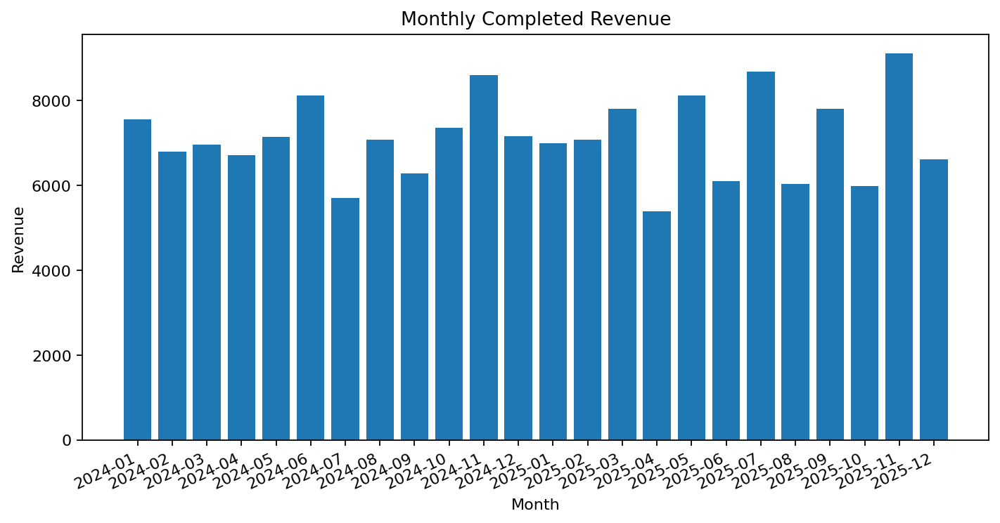
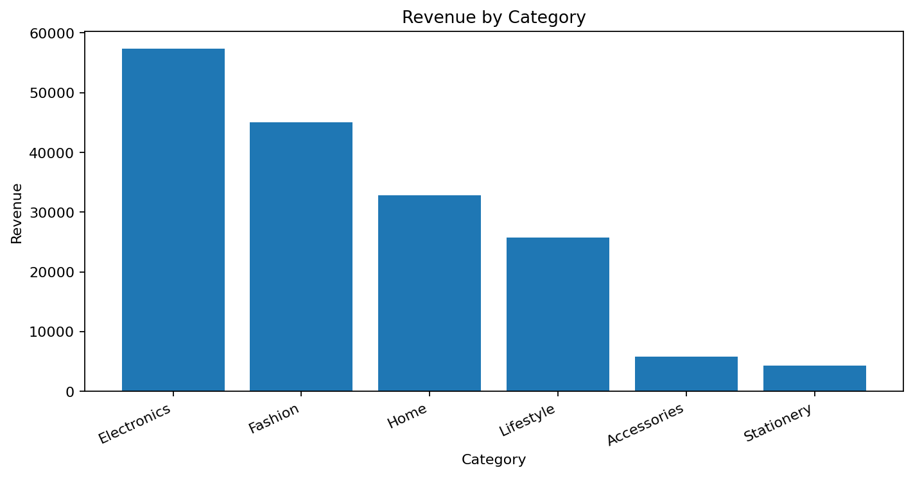
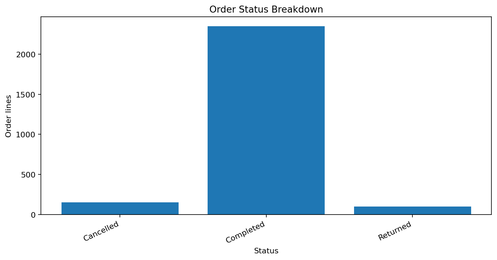

# E-Commerce Customer & Revenue Analytics

A GitHub-ready analytics portfolio project exploring completed-order revenue, repeat purchasing, category performance, order status, and customer RFM features. Charts and results are precomputed so GitHub visitors can review the project without running code.

## Dashboard previews

### Monthly revenue

### Revenue by category

### Order status

## Key metrics from the included practice dataset

| KPI | Result |
|---|---:|
| Completed revenue | 171,118.50 |
| Completed orders | 2,346 |
| Purchasing customers | 399 |
| Average order value | 72.94 |
| Repeat-purchase customers | 391 |
| Repeat customer rate | 97.99% |
| Highest-revenue category | Electronics |

## Questions explored
- Which months and categories contribute the most completed revenue?
- What share of customers place multiple completed orders?
- How are recency, frequency, and monetary value distributed?
- How do cancelled and returned records affect the order-status mix?

## Repository contents
- `data/ecommerce_orders.csv` — synthetic transaction practice data
- `data/monthly_revenue.csv` — monthly completed revenue
- `data/category_revenue.csv` — category-level results
- `data/order_status_summary.csv` — status summary
- `data/customer_rfm.csv` — recency, frequency, monetary features
- `sql/customer_analysis.sql` — PostgreSQL analysis queries
- `dashboard/` — ready-to-display chart previews

## Tools and skills
SQL, Python/Pandas, KPI analysis, customer segmentation foundations, RFM features, retention questions, data visualization, business storytelling.

## Data caveats
This is synthetic practice data, not real company information. Revenue KPIs include only rows marked `Completed`. The dataset is transaction-line shaped, so confirm row grain before applying order counts in other datasets. RFM recency is measured against the latest completed transaction date in this dataset.

## How to use
Open the repository on GitHub to see charts, summaries, SQL, and data. No local execution is needed to view the included results. You can optionally import the CSV into PostgreSQL and adapt the queries.
